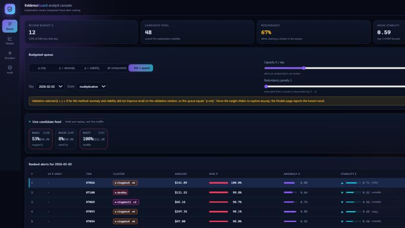
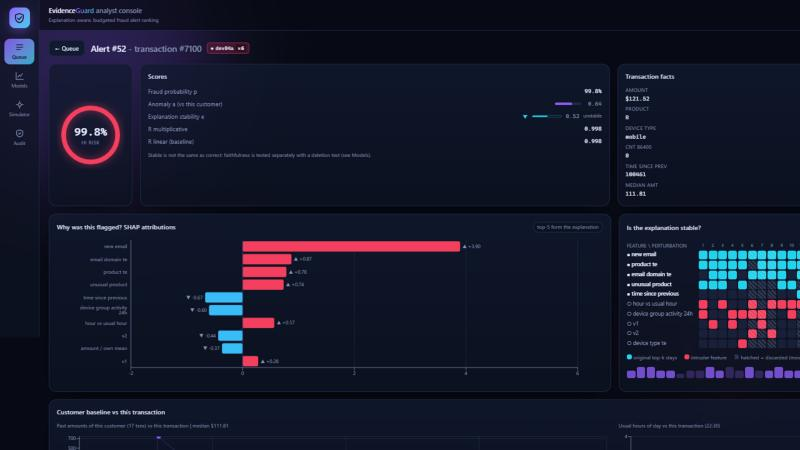
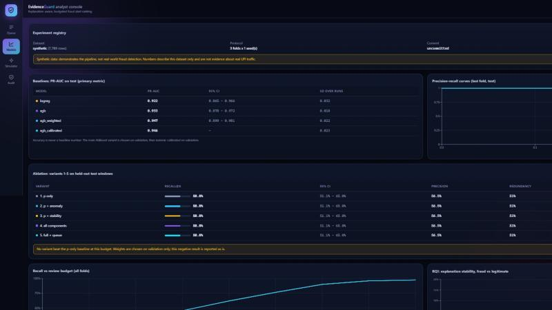
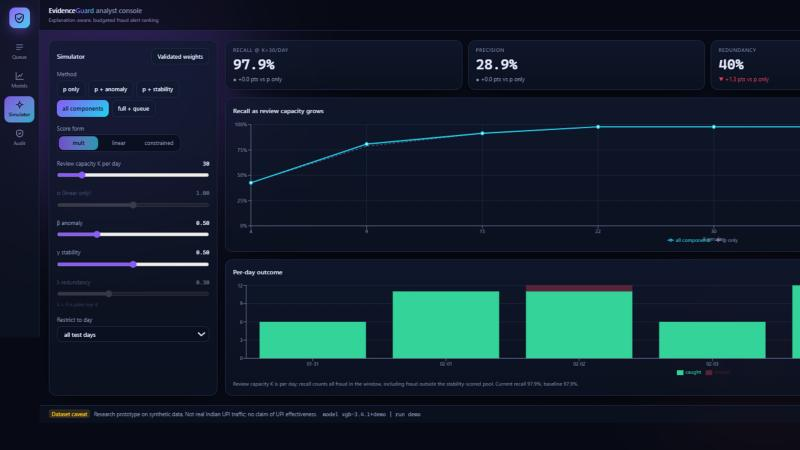
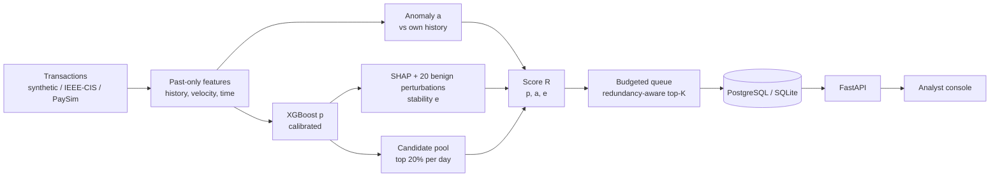

<div align="center">



<br>


**[Quick start](#-quick-start)** &nbsp;|&nbsp; **[Live UI](#-the-live-ui)** &nbsp;|&nbsp; **[How it works](#-how-it-works)** &nbsp;|&nbsp; **[Results](#-demo-results-synthetic-data)** &nbsp;|&nbsp; **[API](#-api)** &nbsp;|&nbsp; **[Testing](#-testing)** &nbsp;|&nbsp; **[Limitations](#-limitations)**

</div>

> [!WARNING]
> **Research prototype.** It runs on a *synthetic* transaction simulator (bundled) and has loaders for IEEE-CIS and PaySim.
> **None of these is real Indian UPI traffic, and nothing here claims UPI effectiveness.** The dashboard footer repeats this on every page.

---

## ✨ The idea

A fraud model gives every transaction a probability **p**. Analysts can only review **K** alerts a day, and a ranked list of
near-duplicates from one stolen device wastes that budget. EvidenceGuard tests three additions to plain *p*-ranking and
**reports honestly whether each one helps**.

<table>
<tr>
<td width="33%" valign="top">

### 🧭 a - personalised anomaly
How unusual is this transaction for *this customer*? Robust z of log-amount, hour and product against their own past;
IsolationForest fallback for new customers.

</td>
<td width="33%" valign="top">

### 🧪 e - explanation stability
Mean Jaccard of the top-5 SHAP features across 20 **benign** perturbations (amount jitter, time shift, resampled
non-essential fields). Perturbations that move *p* by more than delta are discarded.

</td>
<td width="33%" valign="top">

### 🎯 budgeted queue
Greedy top-K under review capacity; every extra alert from the same cluster (device group) is discounted by
`(1 - lambda)`. `lambda = 0` is plain top-K.

</td>
</tr>
</table>

`R = p · (1 + β·a) · (1 − γ + γ·e)` - multiplicative, so anomaly and stability can modulate risk but never rescue a low *p*.
The plan's linear baseline and a *constrained* variant are evaluated alongside. Weights are chosen on **validation only**
(objective: recall at a 5% review budget); every headline number is on **test** windows. Variants: **1** p only · **2** p+a · **3** p+e · **4** all · **5** full with the redundancy-aware queue.

---

## 🖥️ The live UI

<div align="center">

<br><sub>Animated preview of the queue. Alerts stream in, risk and stability bars fill, and rows reorder when the redundancy-aware queue is switched on.</sub>
</div>

<br>

| Page | What you get |
|------|--------------|
| 🗂️ **Queue** | budget slider **K**, five-way method switch with a sliding thumb, λ / β / γ sliders, **rank movement vs p-only** on every row, cluster tags with live duplicate counts, a **live candidate feed** (server-sent events), `j` `k` `Enter` keyboard navigation |
| 🔍 **Evidence** | animated risk gauge, SHAP bars, a **perturbation heatmap** (which features enter or leave the top-5 under each perturbation; discarded runs hatched), customer baseline vs this transaction, cluster peers, decision form |
| 📊 **Models** | PR-AUC with CIs, PR curves, **ablation table with 95% CIs** (validated vs fixed weights, three score forms), recall-vs-budget, stability distribution fraud vs legit, faithfulness, drift, latency, plus an automatic *"reliable improvement or not"* note |
| 🎛️ **Simulator** | live recall / precision / redundancy against the p-only baseline as you move K, α, β, γ, λ |
| 🧾 **Audit** | who viewed or decided what and when; filter, auto-refresh, CSV export |

Designed for analysts: dark and dense, risk shown by colour **and** a numeric bar, stability by its own glyph + word + bar
(never colour alone), command palette (`Ctrl K`), loading skeletons and empty/error states, reduced-motion support, responsive down to tablet width.

<details>
<summary><b>📸 Screenshots</b></summary>






</details>

---

## 🚀 Quick start

```bash
python -m venv venv && source venv/bin/activate     # Windows: venv\Scripts\activate
pip install -r requirements-dev.txt

# the repo ships a small demo database (data/demo.db, ~7.8k synthetic transactions)
DATABASE_URL=sqlite:///data/demo.db uvicorn api.main:app --port 8000      # Windows: set DATABASE_URL=... first
cd web && npm install && npm run dev                                       # dashboard: http://localhost:5173
```

Or build once and let the API serve the dashboard: `cd web && npm install && npm run build`, then open `http://localhost:8000`.
With `make` (Linux / macOS / WSL): `make demo` · `make api` · `make web` · `make ablate` · `make test` · `make test-web`.

<details>
<summary><b>🐳 Docker (PostgreSQL + API + web)</b></summary>

```bash
docker compose up --build        # dashboard http://localhost:8080 (API :8000, PostgreSQL volume)
```

The API image loads the shipped demo database into PostgreSQL on first start (`ml.copy_db --if-empty`) and uses a read-only
role for read endpoints. *The compose setup was written but not run where this was built (no Docker available) - treat it as untested.*

</details>

<details>
<summary><b>🔁 Reproducing results</b></summary>

```bash
python -m ml.run_experiment --config configs/default.yaml     # 3 folds x 1 seed
python -m ml.run_experiment --config configs/full.yaml        # 3 folds x 5 seeds, 2000 bootstrap resamples
```

One config in → `results/<run_id>/` (metrics.json, ablation.csv, baselines.csv, config, git commit, library versions) and database rows out.
Everything is seeded; the same config and seed give identical features and scores (tested). Real data: put the Kaggle IEEE-CIS
files (`train_transaction.csv`, `train_identity.csv`) or PaySim (`PS_*.csv`) in `data/raw/` and set `data.source` to `ieee_cis` or `paysim`.
**The loaders are unit-tested on tiny fixtures only; they have not been run on the real files.**

</details>

---

## 🧠 How it works



<details>
<summary><b>🔒 Leakage rules (enforced by tests)</b></summary>

- A feature for transaction *t* uses only rows with time **strictly earlier** than *t* (ties excluded). Test: recompute on a dataset cut at time T, and with a changed future row - earlier rows must be identical.
- Target encoding, imputation and scaling are fitted on the training window; calibration on validation.
- No label or outcome field is a model input; labels are evaluation-only (the API hides them unless `reveal=true`).
- Splits are chronological and validated (`assert_chronological` fails loudly); a shuffled-time test confirms performance drops when time order is destroyed.
- Entity proxy: `card1 + addr1` (an assumption, as in the plan). It contains the address, so "new address" cannot occur; the flags are new-device and new-email.

</details>

<details>
<summary><b>📁 Project layout</b></summary>

```
configs/    YAML: data, splits, features, models, stability, ranking grids, evaluation (default, full, demo)
ml/         data.py features.py models.py anomaly.py stability.py ranking.py metrics.py run_experiment.py
            store.py (schema)  synth.py (simulator)  copy_db.py  make_data.py  config.py
api/        main.py schemas.py db.py core.py routers/{alerts,simulate,experiments,audit,stream}.py
web/        React + TypeScript + Tailwind dashboard, vitest tests (mocked API)
tests/      leakage, stability, ranking, metrics, data loaders, database copy, API (real tiny end-to-end run)
db/init.sql read-only role · Dockerfile.api / Dockerfile.web / docker-compose.yml · Makefile · results/ (versioned run output)
```

</details>

---

## 📈 Demo results (synthetic data)

> These come from `configs/demo.yaml` (7,789 simulated transactions, 3.7% fraud, 3 chronological folds, 1 seed). They show the
> pipeline works - **not** that the method detects real fraud.

| Model - test PR-AUC | logreg | xgboost | xgboost weighted | calibrated main |
|---|---|---|---|---|
| mean over folds | 0.922 | 0.933 | 0.947 | 0.946 |

Recall of all fraud at a 5% daily review budget (95% bootstrap CI):

| Variant | Weights | recall@5% |
|---|---|---|
| 1. p only | - | **58.8%** (51 - 65) |
| 2-5. with a, e, queue | **β = γ = λ = 0 selected on validation** | 58.8% (identical to p only) |
| 5. full, *fixed* weights 0.5 / 0.5 / 0.3 | not validated | 54.2% (47 - 61), redundancy 51% → 41% |

**What this honestly says.** On this simulator, anomaly and stability did **not** improve recall on validation, so the search kept
them at zero and the method reduces to p-only. Stability differed only weakly between fraud and legitimate alerts (mean 0.71 vs 0.66,
Mann-Whitney p = 0.054). The deletion test shows SHAP's top-5 features matter more than random ones (mean p drop 0.22 vs 0.06). The
redundancy-aware queue cuts duplicate alerts sharply at small budgets (1% budget: 47% → 4% redundancy, same recall) but costs recall
at 5%. That is the plan's "valid negative result" outcome, and the dashboard states it automatically instead of hiding it.

---

## 🔌 API

Interactive docs at `/docs`.

| Method | Endpoint | Purpose |
|--------|----------|---------|
| GET | `/api/alerts?day=&method=&k=&lam=&mode=&beta=&gamma=` | ranked, budgeted queue |
| GET | `/api/alerts/{id}` | evidence: scores, SHAP, perturbation runs, customer baseline, cluster peers |
| POST | `/api/alerts/{id}/decision` | analyst verdict (writes `decisions` + `audit_log`) |
| POST | `/api/simulate` | re-rank with chosen weights, K, λ; recall / precision / redundancy vs p-only |
| GET | `/api/experiments`, `/api/experiments/{run}/curves` | registry, PR curves, recall vs budget, ablation |
| GET | `/api/audit`, `/api/audit/export.csv` | paged audit trail (CSV is formula-injection safe) |
| GET | `/api/stream` | SSE replay of held-out candidate alerts (not live traffic) |
| GET | `/api/health`, `/api/meta` | liveness; run, model version, dataset caveat |

Security basics: parameterised SQL (SQLAlchemy), CORS limited to the web origin, no secrets in git, read-only role for read endpoints in Docker.
The prototype has **no user authentication** - the analyst name is self-declared and recorded in the audit log. Add real auth before any shared deployment.

---

## 🧪 Testing

```bash
python -m pytest -q          # 41 tests: leakage, determinism, stability, ranking, metrics, loaders, API, DB copy
cd web && npm test           # 10 tests: every page against a mocked API, keyboard use, decision POST, error state
```

---

## ⚠️ Limitations

- Results on synthetic data demonstrate the pipeline only. The real-data loaders are untested on the real files.
- The perturbation set is one definition of "benign"; sensitivity to the 2% vs 5% amount tolerance and to delta is configurable but not yet swept.
- Stability is computed for the top 20% of each day by p (the candidate pool), so every method re-ranks the same pool; recall is still measured against *all* fraud in the window.
- Entity proxies are assumptions; sensitivity to alternatives is not yet run.
- Docker Compose is untested here; the API has no authentication.

<br>

<div align="center">

</div>
